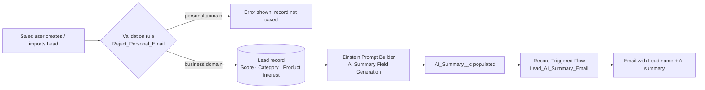

# AI-Powered Lead Generation System

A Salesforce project that captures **business-only leads**, scores and categorises them, generates an **AI summary** for each lead with **Einstein Prompt Builder (Agentforce)**, and automatically **emails the summary** using a Record-Triggered Flow.

> Author: Maithaly Yogesh Patil  
> Platform: Salesforce Developer Org (Lightning Experience) · Einstein Generative AI / Agentforce

---

## Features

| # | Feature | Built with |
|---|---------|-----------|
| 1 | Custom Lead fields: **Lead Score, Lead Category, Product Interest, AI Summary** | Custom fields on the standard `Lead` object |
| 2 | Blocks personal e-mail domains (Gmail, Yahoo, Hotmail, Outlook) | Validation rule `Reject_Personal_Email` |
| 3 | One-click AI summary of a lead | Einstein **Prompt Builder** – *Field Generation* template |
| 4 | Automatic e-mail with the lead name and AI summary | Record-Triggered Flow `Lead_AI_Summary_Email` |
| 5 | Dedicated workspace for sales users | Lightning App **AI Lead Generation** |
| 6 | Controlled access to the app and fields | Permission set `AI_Lead_Gen_Access`, profiles, roles |

## Architecture



## Repository structure

```
AI-Powered-Lead-Generation-System/
├── force-app/main/default/
│   ├── objects/Lead/fields/            4 custom fields
│   ├── objects/Lead/validationRules/   Reject_Personal_Email
│   ├── flows/                          Lead_AI_Summary_Email
│   ├── applications/                   AI_Lead_Generation (Lightning app)
│   └── permissionsets/                 AI_Lead_Gen_Access
├── data/                               sample leads (valid + negative test)
├── docs/
│   ├── PROJECT_DOCUMENTATION.md        full project report (all phases)
│   ├── manual_setup_steps.md           steps done in the Salesforce UI
│   └── screenshots/                    put labelled screenshots here
├── scripts/deploy.sh                   one-command deploy
└── sfdx-project.json
```

## Quick start

**Prerequisites:** a free [Salesforce Developer Org](https://developer.salesforce.com/signup) and the [Salesforce CLI](https://developer.salesforce.com/tools/salesforcecli) (`sf`).

```bash
# 1. Deploy metadata, assign the permission set and import sample leads
./scripts/deploy.sh leadgen

# or step by step
sf org login web --alias leadgen
sf project deploy start --source-dir force-app --target-org leadgen
sf org assign permset --name AI_Lead_Gen_Access --target-org leadgen
sf data import bulk --sobject Lead --file data/sample_leads_valid.csv --wait 10 --target-org leadgen
```

Then complete the parts that are configured in the Salesforce UI (Einstein, Prompt Builder, Lightning record page, roles and users) by following **[docs/manual_setup_steps.md](docs/manual_setup_steps.md)**.

## Testing

* Import `data/sample_leads_negative_test.csv` → every row must be rejected by the validation rule.
* Open a lead → click the AI icon on **AI Summary** → *Use* → *Save* → the flow sends the e-mail.
* Full test-case table: [docs/PROJECT_DOCUMENTATION.md](docs/PROJECT_DOCUMENTATION.md#7-data-migration-testing--security).

## Notes

* The flow e-mails the address stored on the lead (`{!$Record.Email}`). The sample data uses `example.com` addresses, so nothing is delivered to real people. Use your own business-domain address when you want to see the e-mail arrive.
* Einstein Generative AI / Prompt Builder availability depends on your org edition and region.
