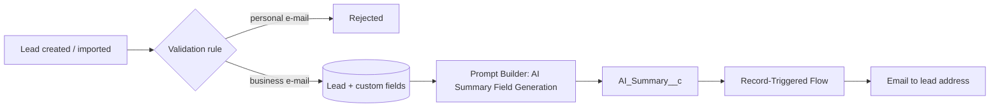

# AI-Powered Lead Generation System — Project Documentation

| | |
|---|---|
| **Project title** | AI-Powered Lead Generation System |
| **Platform** | Salesforce (Lightning Experience) with Einstein Generative AI / Agentforce Prompt Builder |
| **Prepared by** | Maithaly Yogesh Patil |
| **Program** | Salesforce Administrator with AI & Agentforce (SkillWallet) |

## Table of contents
1. [Introduction](#1-introduction)
2. [Understanding Business Requirements](#2-understanding-business-requirements)
3. [Defining Project Scope and Objectives](#3-defining-project-scope-and-objectives)
4. [Solution Architecture](#4-solution-architecture)
5. [Backend Development & Configurations](#5-backend-development--configurations)
6. [UI/UX Development and Customization](#6-uiux-development-and-customization)
7. [Data Migration, Testing & Security](#7-data-migration-testing--security)
8. [Deployment, Documentation & Maintenance](#8-deployment-documentation--maintenance)
9. [User Adoption and Change Management](#9-user-adoption-and-change-management)
10. [Conclusion and Future Enhancements](#10-conclusion-and-future-enhancements)

---

## 1. Introduction
Sales teams receive leads from many channels (web forms, events, referrals, ads). Reviewing each record by hand to understand who the lead is, how promising it is and what to do next is slow and inconsistent. This project uses Salesforce to capture clean business leads, classify them, and use generative AI to write a readable summary of each lead that is then e-mailed automatically.

Salesforce is a customer success platform for selling, servicing, marketing and analysing customer data in the cloud. Before such a platform, contacts, e-mails, follow-up tasks and deals are scattered across notebooks and spreadsheets; Salesforce brings them into one secure place.

## 2. Understanding Business Requirements

### 2.1 Stakeholders and user roles
| Stakeholder | Interest |
|---|---|
| Sales Representative | Quickly understand a lead and act on it |
| Sales Manager | Prioritise Hot leads, monitor lead quality |
| Salesforce Administrator | Configure, secure and maintain the system |
| Marketing Team | Supply leads and measure lead sources |

### 2.2 Pain points
* Leads with personal e-mail addresses reduce quality and are rarely business buyers.
* No consistent way to score or categorise a lead.
* Reading every lead record in detail takes time.
* Follow-up communication is manual.

### 2.3 Functional requirements
| ID | Requirement |
|----|-------------|
| FR-1 | Store **Lead Score** (number), **Lead Category** (Hot/Warm/Cold), **Product Interest** (Training/Consulting/Certification) on each lead |
| FR-2 | Reject leads whose e-mail is Gmail, Yahoo, Hotmail or Outlook |
| FR-3 | Generate a structured **AI Summary** of a lead on demand |
| FR-4 | Automatically e-mail the lead name and AI summary when the summary is saved |
| FR-5 | Provide a dedicated Lightning app for sales users |
| FR-6 | Restrict access using profiles, roles and permission sets |

### 2.4 Non-functional requirements
* **Security:** field-level and object-level access controlled by permission set and profile.
* **Usability:** AI generation is one click from the lead page.
* **Maintainability:** configuration-first (declarative) solution, no custom code; metadata kept in version control.
* **Reliability:** validation prevents bad data from entering the system.

## 3. Defining Project Scope and Objectives

### 3.1 Objectives (measurable)
1. 100 % of saved leads use a business e-mail domain.
2. Every lead can carry a score, category and product interest.
3. AI summary generated in a single click and stored on the lead.
4. E-mail sent automatically the first time an AI summary is saved.

### 3.2 In scope
Lead object customisation, validation, Prompt Builder template, record-triggered flow, Lightning app, security setup (profile, role, user, permission set), sample data load and test cases.

### 3.3 Out of scope
Custom Apex/LWC development, web-to-lead forms, lead conversion automation, external integrations, ML-based scoring models.

### 3.4 Success criteria
All test cases in section 7 pass; the validation rule blocks the four personal domains; the AI summary and e-mail are produced for a sample lead.

## 4. Solution Architecture



### 4.1 Data model
Standard `Lead` object extended with:

| Field Label | API Name | Data Type | Values |
|---|---|---|---|
| Lead Score | `Lead_Score__c` | Number (3,0) | 0–100 |
| Lead Category | `Lead_Category__c` | Picklist | Hot, Warm, Cold |
| Product Interest | `Product_Interest__c` | Picklist | Training, Consulting, Certification |
| AI Summary | `AI_Summary__c` | Long Text Area (32,000 chars, 10 lines) | AI-generated text |

> The guide's generic example of creating a custom object (e.g. *Projects*) with tabs is the standard procedure; for this project the existing **Lead** object is used, so its standard *Leads* tab is used in the app and no extra custom object/tab is required.

## 5. Backend Development & Configurations

### 5.1 Salesforce account
Sign up at `https://developer.salesforce.com/signup` with first/last name, e-mail, Role = *Developer*, Company = college/organisation name, Country = India, postal code, and a unique username in e-mail format (it need not be a real mailbox). Verify via the activation e-mail (can take 5–10 minutes), set a password and a security question.

### 5.2 Objects and tabs
General procedure used for any custom object: *Setup → Object Manager → Create → Custom Object*, set Label, Plural Label, Record Name (Text or Auto-Number such as `PROJ-{0000}`), enable Reports, Activities, Field History, Search, Notes & Attachments, choose *Deployed*, and save. Tabs: *Setup → Tabs → Custom Object Tabs → New*, choose the object and style, set visibility (Default On / Default Off / Tab Hidden) per profile, add to apps, save, then verify in the App Launcher. For this project the standard **Leads** tab is used.

### 5.3 Fields and relationships
Created under *Object Manager → Lead → Fields & Relationships → New* (the four fields in 4.1). Steps for *AI Summary*: choose **Long Text Area**, label `AI Summary`, length 32,000, visible lines 10, set field-level security, add to the page layout, save. Source: `force-app/main/default/objects/Lead/fields/`.

### 5.4 Application creation
*Setup → App Manager → New Lightning App* → name **AI Lead Generation** → branding → navigation items (Home, **Leads**, Reports, Dashboards) → user profiles → save. Source: `force-app/main/default/applications/AI_Lead_Generation.app-meta.xml`.

### 5.5 Validation rule
*Setup → Object Manager → Lead → Validation Rules → New*

* **Rule name:** `Reject_Personal_Email`  ·  **Active:** checked
* **Error condition formula:**

```text
OR(
    CONTAINS(LOWER(Email), "@gmail."),
    CONTAINS(LOWER(Email), "@yahoo."),
    CONTAINS(LOWER(Email), "@hotmail."),
    CONTAINS(LOWER(Email), "@outlook.")
)
```
* **Error message:** *Personal email domains like Gmail, Yahoo, Hotmail, and Outlook are not allowed*
* **Error location:** Email field

`LOWER()` is added so that e-mails typed in capital letters (e.g. `@GMAIL.com`) are also blocked.

### 5.6 Record-Triggered Flow
*Setup → Flows → New Flow → Triggered → Record-Triggered Flow*

| Setting | Value |
|---|---|
| Object | Lead |
| Trigger | A record is created or updated |
| Entry conditions | `AI_Summary__c` is not blank **and** `Email` is not blank |
| Run when | Only when a record is updated to meet the condition requirements (so the mail is sent once, not on every edit) |
| Optimise for | Actions and Related Records (after save) |
| Action | **Send Email** — label *Send Lead Email* |
| Recipient | `{!$Record.Email}` |
| Subject | Your Lead Summary - AI Powered Lead Generation System |
| Body (HTML) | `{!$Record.Name}`, `{!$Record.AI_Summary__c}`, `{!$Record.Id}` |
| Sender type | Current User (or Org-Wide Email Address) |
| Is HTML body | True |

Click **Done → Activate**. Source: `force-app/main/default/flows/Lead_AI_Summary_Email.flow-meta.xml`.

### 5.7 Agentforce / Einstein Prompt Builder
1. *Setup → Einstein Setup → Turn on Einstein* (refresh).
2. *Setup → Prompt Builder → New Prompt Template* → type **Field Generation** → label *AI Summary Field Generation* → object *Lead*, field *AI Summary*.
3. Insert resources: Full Name, Company, Email, Phone, Lead Source, Lead Status, Description.
4. Prompt text:

```text
Generate a detailed summary of this Lead using the selected fields.
Explain the Lead's background, company information, contact details, status, source, and any key notes clearly.
Summarize relevant details such as the current engagement stage, potential interest level, communication history, and any important remarks.
Provide the summary in a clean, structured, and easy-to-understand format.
```
5. **Save → Activate.** Detailed click-path: `docs/manual_setup_steps.md`.

## 6. UI/UX Development and Customization
* **Lightning App Builder:** open any lead → gear icon → *Edit Page* → Record Detail → Lead Layout → select the *AI Summary* field → choose the Field Generation template → *Save → Activate → Assign as Org Default (Desktop)*.
* **Result:** an **AI icon** appears on the AI Summary field. Clicking it generates the summary; the user reviews it and presses *Use* then *Save*.
* **Navigation:** the *AI Lead Generation* app shows Home, Leads, Reports and Dashboards in a clean, branded header (`#0176D3`).
* **Page layout tips:** group Lead Score, Lead Category and Product Interest in a "Lead Qualification" section; keep AI Summary in a full-width section.

## 7. Data Migration, Testing & Security

### 7.1 Data migration
* Source files: `data/sample_leads_valid.csv` (10 business leads) and `data/sample_leads_negative_test.csv` (4 personal-domain leads).
* Method: **Data Import Wizard** (Setup → Data Import Wizard → Leads) or `sf data import bulk --sobject Lead --file …`.
* Field mapping: FirstName, LastName, Company, Email, Phone, LeadSource, Status, Description, Lead_Score__c, Lead_Category__c, Product_Interest__c.
* Data validation: after import run *Leads: All Open Leads* list view and compare the record count with the CSV (expected 10). The negative file must import 0 records.
* Inconsistency handling: error file from the import shows the row and the validation message.

### 7.2 Test cases
| ID | Type | Scenario | Expected result | Status |
|----|------|----------|-----------------|--------|
| TC-01 | Functional | Create lead with `name@company-domain.com` | Saved successfully | ☐ |
| TC-02 | Validation | Create lead with `@gmail.com` | Blocked with the error message under Email | ☐ |
| TC-03 | Validation | Repeat for `@yahoo.com`, `@hotmail.com`, `@outlook.com` | All blocked | ☐ |
| TC-04 | Validation | E-mail typed as `USER@GMAIL.COM` | Blocked (rule is case-insensitive) | ☐ |
| TC-05 | Field | Lead Category / Product Interest picklists | Only the listed values selectable | ☐ |
| TC-06 | AI | Click AI icon on AI Summary | Structured summary generated | ☐ |
| TC-07 | Flow | Save the generated summary | E-mail with name + summary sent once | ☐ |
| TC-08 | Flow | Edit another field afterwards | No second e-mail | ☐ |
| TC-09 | Security | User **without** the permission set opens a lead | Custom fields / app not visible | ☐ |
| TC-10 | Data | Import `sample_leads_valid.csv` | 10 records created | ☐ |
| TC-11 | Data | Import `sample_leads_negative_test.csv` | 0 records, 4 errors | ☐ |
| TC-12 | Usability | Open *AI Lead Generation* app from App Launcher | App opens with Leads tab | ☐ |

Mark the Status column (✔ / ✘) after executing the tests in your org and attach screenshots.

### 7.3 Security
* **Profiles:** object permissions (Read, Create, Edit, Delete, View All, Modify All), field-level security, tab settings (Default On / Off / Hidden), app and system permissions, record-type assignment. A custom profile can be created by *Clone*.
* **Permission set:** `AI_Lead_Gen_Access` grants the app, Lead create/read/edit and the four custom fields.
* **Roles:** CEO → Sales Manager → Sales Representative; managers see their team's leads.
* **Users:** created with profile + role; can be deactivated, frozen or password-reset by the admin.
* **Data protection:** validation rule blocks personal data domains; Einstein Trust Layer governs what is sent to the AI model.

## 8. Deployment, Documentation & Maintenance

### 8.1 Deployment
1. Install Salesforce CLI, run `./scripts/deploy.sh <org-alias>`.
2. Complete UI steps in `docs/manual_setup_steps.md`.
3. Smoke-test using TC-01, TC-02, TC-06 and TC-07.

For moving to production use change sets or `sf project deploy start --target-org <prod>` after testing in a sandbox.

### 8.2 Documentation and submission guidelines followed
* Consistent structure with clear headings and complete details: requirements, architecture, configuration steps, testing results, deployment steps.
* All screenshots labelled (`docs/screenshots/README.md` lists the 15 required images).
* Code/configuration formatted and explained (formulas, flow settings, prompt text).
* Files named clearly and compiled into one repository / folder; submit before the deadline.

### 8.3 Maintenance
| Task | Frequency |
|---|---|
| Review flow error e-mails and debug logs | Weekly |
| Review the personal-domain list (add `@icloud.`, `@proton.` etc. if needed) | Quarterly |
| Review and refine the Prompt Template wording | Quarterly |
| Audit users, roles, permission-set assignments | Quarterly |
| Check Salesforce seasonal release notes (Einstein/Flow changes) | 3 × a year |

## 9. User Adoption and Change Management
* **Communication plan:** announce the change, explain the benefits (less reading time, cleaner data) and give a go-live date.
* **Role-based training:** 30-minute session for Sales Reps (create lead, generate AI summary), separate session for Managers (reports) and Admins (maintenance).
* **Pilot:** release to a small team first and collect feedback.
* **Support:** quick-reference guide, Chatter/Slack channel, named admin contact.
* **Reinforcement:** dashboard of AI-summary usage and lead quality; recognise teams with high adoption.
* **Outcome:** reduced resistance, higher confidence and better return on investment.

## 10. Conclusion and Future Enhancements
The system improves lead quality at the door, standardises lead classification and saves reading time through AI summaries and automatic communication. All of it is configured declaratively and is version-controlled.

Possible enhancements:
* Auto-calculate Lead Score and Category using formula or Flow logic.
* Send the summary to the **Lead Owner** (change recipient to `{!$Record.Owner.Email}`) instead of the lead.
* Web-to-Lead form with the same validation.
* Dashboards for leads by category, product interest and source.
* Agentforce agent that follows up with Hot leads.
